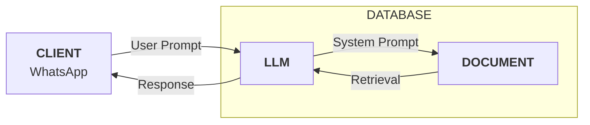

# AI-Powered Legal Assistant 🚀

An AI-powered legal assistant that specializes in specific legal domains within a particular jurisdiction.

This assistant will provide accurate legal information cited from the actual law(s) within the jurisdiction to users via WhatsApp.

## 🧭 Table of contents

- [🌟 Overview](#-overview)
    - [Project scope 🔭](#project-scope-)
- [🛠️ My process](#️-my-process)
    - [Architecture 🏛️](#architecture-️)
    - [Built with 🧱]()
    - [What I learned 🧠]()
    - [Continued development 🌱]()
    - [Useful resources 📚]()
- [👩🏽‍💻 Author](#-author)

## 🌟 Overview

### Project scope 🔭

The components for this project include:

- Documents for grounding the data
- Vector database
- Large Language Model (LLM)
- LLM orchestrator
- Programming language i.e. `Python`
- WhatsApp integration

## 🛠️ My process

### Architecture 🏛️

## 👩🏽‍💻 Author

| Platform | Link |
| :--- | :--- |
| **Technical Blog** | [https://grace-sampao.github.io/](https://grace-sampao.github.io/) |
| **LinkedIn** | [Grace Sampao](https://www.linkedin.com/in/grace-sampao) |
| **X (formerly Twitter)** | [@grace-sampao](https://x.com/grace_sampao) |
| **Email** | sampaograce@gmail.com |
